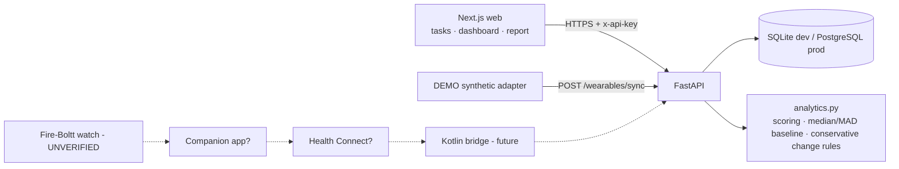

# Architecture

- Web never connects to the watch. Health Connect is phone-side, not a live stream.
- Trial-level events stored (`assessment_trials`); metrics derived transparently — no composite score.
- Baseline: median centre + MAD variability per metric, confidence `building <3 · moderate 3–4 · established ≥5` valid sessions.
- Change: only after ≥4 sessions and 2 recent points beyond `max(2·MAD, 10% centre)` same direction → "possible change", never a diagnosis.
- Wearable ingestion validates record type/unit, dedupes on `source_record_id`, stores provenance. Ownership comes from server-side user, never client-supplied `user_id`.
